# ambientCG: Bricks materials

**27 assets from [ambientCG](https://ambientcg.com), dedicated to the public domain under [CC0](https://docs.ambientcg.com/license/).** Use them in any game, free or paid, and change them however you like; no credit is needed.

PBR materials as 1K and 2K JPG maps (colour, normal GL and DX, roughness, AO, displacement), one folder per resolution. 886.3 MB in all.

This is a copy kept by [zuujis-cc0](https://github.com/zuujis-cc0) so game makers can take single files from GitHub. It is not made by or affiliated with ambientCG: the originals, often in more formats and higher resolutions, are on [ambientcg.com](https://ambientcg.com). If they help you, consider [supporting ambientCG](https://www.patreon.com/ambientCG).

Every file is listed in [MANIFEST.tsv](MANIFEST.tsv) with its size and SHA-256. More free assets: [the Zuujis collection](https://github.com/zuujis-cc0/free-game-assets#readme).

| | | | |
| :-: | :-: | :-: | :-: |
| <a href="Bricks001">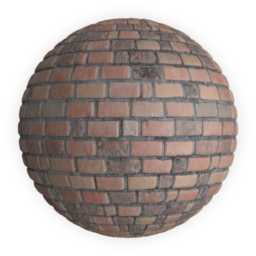</a> <b><a href="Bricks001">Bricks 001</a></b> by ambientCG · <a href="https://ambientcg.com/a/Bricks001">source</a> | <a href="Bricks002">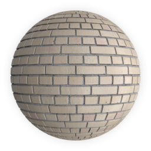</a> <b><a href="Bricks002">Bricks 002</a></b> by ambientCG · <a href="https://ambientcg.com/a/Bricks002">source</a> | <a href="Bricks003">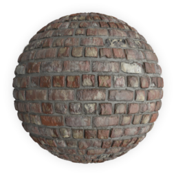</a> <b><a href="Bricks003">Bricks 003</a></b> by ambientCG · <a href="https://ambientcg.com/a/Bricks003">source</a> | <a href="Bricks004">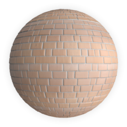</a> <b><a href="Bricks004">Bricks 004</a></b> by ambientCG · <a href="https://ambientcg.com/a/Bricks004">source</a> |
| <a href="Bricks005">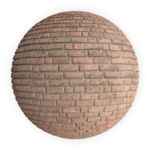</a> <b><a href="Bricks005">Bricks 005</a></b> by ambientCG · <a href="https://ambientcg.com/a/Bricks005">source</a> | <a href="Bricks006">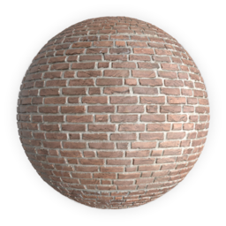</a> <b><a href="Bricks006">Bricks 006</a></b> by ambientCG · <a href="https://ambientcg.com/a/Bricks006">source</a> | <a href="Bricks007">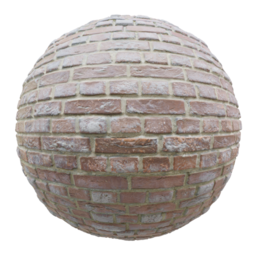</a> <b><a href="Bricks007">Bricks 007</a></b> by ambientCG · <a href="https://ambientcg.com/a/Bricks007">source</a> | <a href="Bricks008">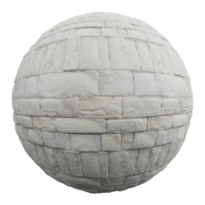</a> <b><a href="Bricks008">Bricks 008</a></b> by ambientCG · <a href="https://ambientcg.com/a/Bricks008">source</a> |
| <a href="Bricks009">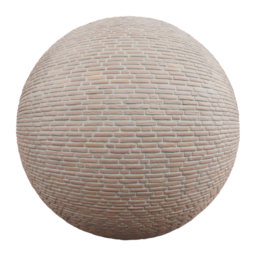</a> <b><a href="Bricks009">Bricks 009</a></b> by ambientCG · <a href="https://ambientcg.com/a/Bricks009">source</a> | <a href="Bricks010">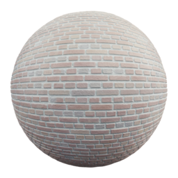</a> <b><a href="Bricks010">Bricks 010</a></b> by ambientCG · <a href="https://ambientcg.com/a/Bricks010">source</a> | <a href="Bricks011">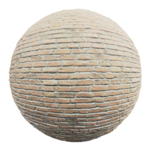</a> <b><a href="Bricks011">Bricks 011</a></b> by ambientCG · <a href="https://ambientcg.com/a/Bricks011">source</a> | <a href="Bricks012">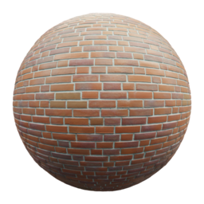</a> <b><a href="Bricks012">Bricks 012</a></b> by ambientCG · <a href="https://ambientcg.com/a/Bricks012">source</a> |
| <a href="Bricks013">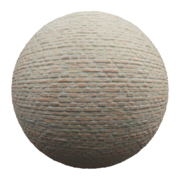</a> <b><a href="Bricks013">Bricks 013</a></b> by ambientCG · <a href="https://ambientcg.com/a/Bricks013">source</a> | <a href="Bricks014">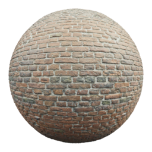</a> <b><a href="Bricks014">Bricks 014</a></b> by ambientCG · <a href="https://ambientcg.com/a/Bricks014">source</a> | <a href="Bricks015">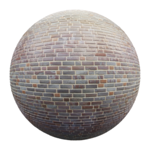</a> <b><a href="Bricks015">Bricks 015</a></b> by ambientCG · <a href="https://ambientcg.com/a/Bricks015">source</a> | <a href="Bricks016">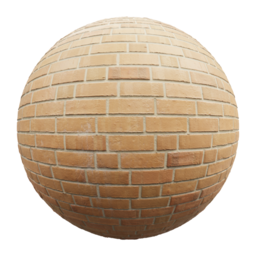</a> <b><a href="Bricks016">Bricks 016</a></b> by ambientCG · <a href="https://ambientcg.com/a/Bricks016">source</a> |
| <a href="Bricks017">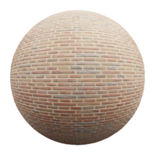</a> <b><a href="Bricks017">Bricks 017</a></b> by ambientCG · <a href="https://ambientcg.com/a/Bricks017">source</a> | <a href="Bricks018">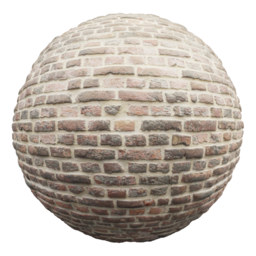</a> <b><a href="Bricks018">Bricks 018</a></b> by ambientCG · <a href="https://ambientcg.com/a/Bricks018">source</a> | <a href="Bricks019">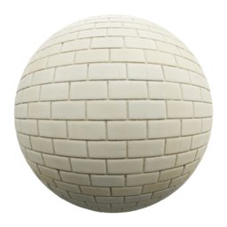</a> <b><a href="Bricks019">Bricks 019</a></b> by ambientCG · <a href="https://ambientcg.com/a/Bricks019">source</a> | <a href="Bricks020">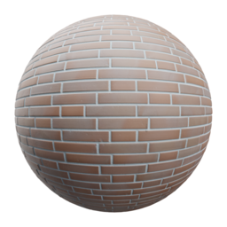</a> <b><a href="Bricks020">Bricks 020</a></b> by ambientCG · <a href="https://ambientcg.com/a/Bricks020">source</a> |
| <a href="Bricks021">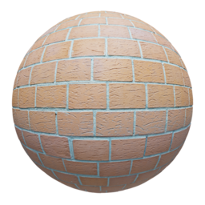</a> <b><a href="Bricks021">Bricks 021</a></b> by ambientCG · <a href="https://ambientcg.com/a/Bricks021">source</a> | <a href="Bricks022">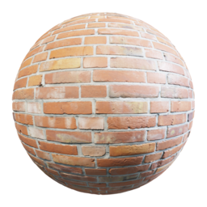</a> <b><a href="Bricks022">Bricks 022</a></b> by ambientCG · <a href="https://ambientcg.com/a/Bricks022">source</a> | <a href="Bricks023">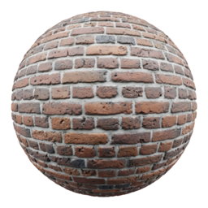</a> <b><a href="Bricks023">Bricks 023</a></b> by ambientCG · <a href="https://ambientcg.com/a/Bricks023">source</a> | <a href="Bricks024">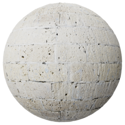</a> <b><a href="Bricks024">Bricks 024</a></b> by ambientCG · <a href="https://ambientcg.com/a/Bricks024">source</a> |
| <a href="Bricks025">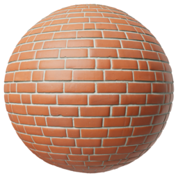</a> <b><a href="Bricks025">Bricks 025</a></b> by ambientCG · <a href="https://ambientcg.com/a/Bricks025">source</a> | <a href="Bricks026">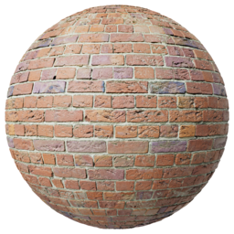</a> <b><a href="Bricks026">Bricks 026</a></b> by ambientCG · <a href="https://ambientcg.com/a/Bricks026">source</a> | <a href="Bricks027">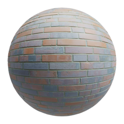</a> <b><a href="Bricks027">Bricks 027</a></b> by ambientCG · <a href="https://ambientcg.com/a/Bricks027">source</a> |  |

---

Kept up to date by this repository's own [update workflow](.github/workflows/update.yml), with code and plan from [cc0-mirror](https://github.com/zuujis-cc0/cc0-mirror). Something wrong? [Open an issue there](https://github.com/zuujis-cc0/cc0-mirror/issues/new) or use the [private report form](https://games.zuujis.com/report).
